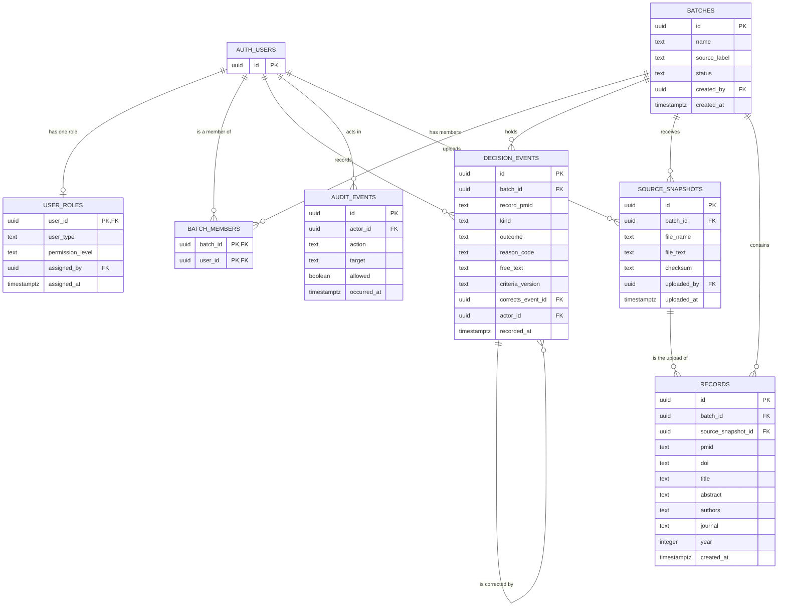

# Database diagram

Tables in the migrations (`supabase/migrations/`). Planned tables are in `docs/database-design.md`, not here, because they are not in a migration yet.

`auth.users` is Supabase's sign-in table. It is shown for the links only.

Rules shown in the diagram:
- A correction or resolution must point to an event in the same batch (`corrects_event_id`).
- A new batch's creator is added to the batch's members automatically.
- Decision events, audit events, source files, and records are never updated or deleted (enforced by the database).
- A record's source file must be in the same batch (`source_snapshot_id`).
- Each PubMed ID appears once per batch (`pmid` within `batch_id`).
- Each person has at most one role row.
